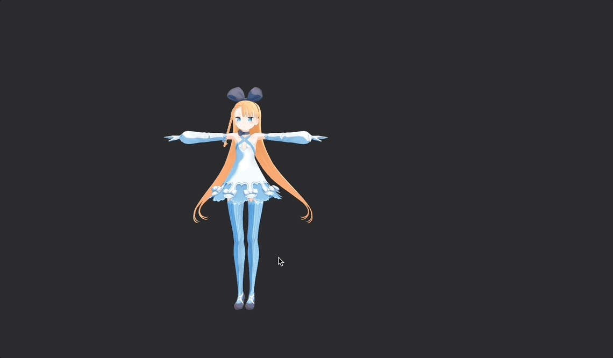
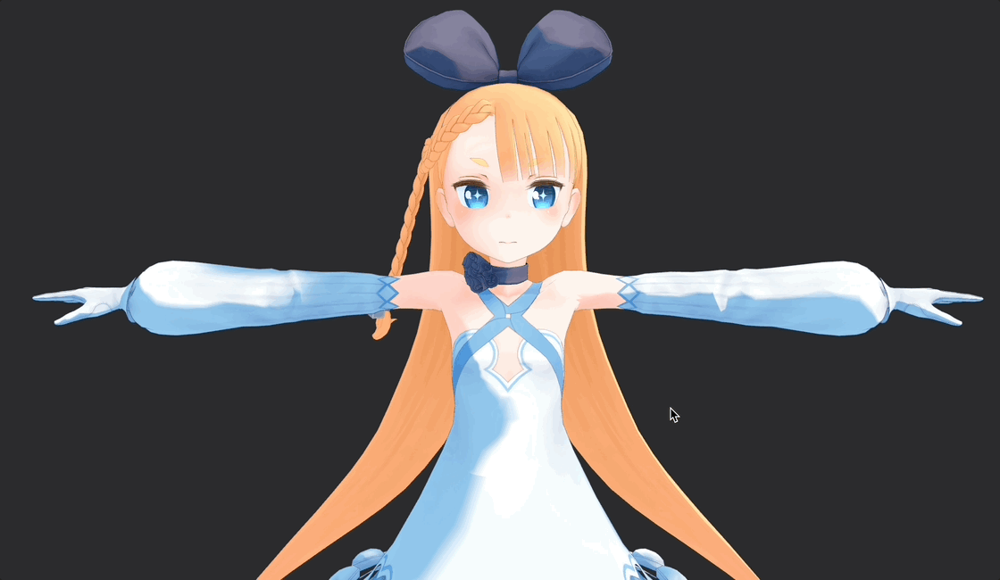
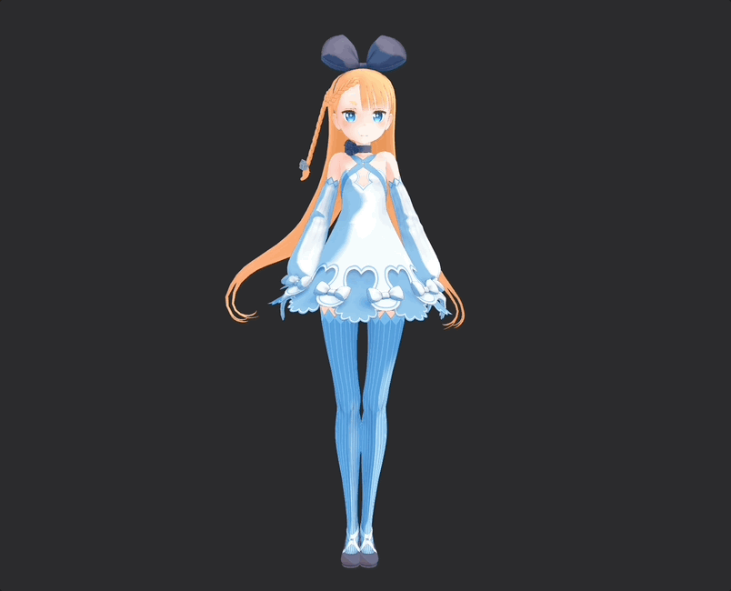

# bevy_vrm1

[](https://crates.io/crates/bevy_vrm1)
[](https://docs.rs/bevy_vrm1/latest/bevy_vrm1/)

> [!CAUTION]
> This crate is in an early stage of development and may undergo breaking changes.

> [!NOTE]
> This crate only supports VRM 1.0.

This crate allows you to use [VRM1.0](https://vrm.dev/en/vrm/vrm_about/) and [VRMA](https://vrm.dev/en/vrma/).

## Usage

| Name            | currently supported |
| --------------- | ------------------- |
| Spring Bone     | ✅                  |
| Look At         | ✅                  |
| Animation(vrma) | ✅                  |
| Node Constraint | ✅                  |
| First Person    | ✅                  |

### Loading

A `.vrm` loads through the stock Bevy glTF loader. `VrmGltfPlugin` claims the `vrm` file extension and writes every VRM component into the scene asset **while the file loads**; those handler computations stay at load time, and a thin scene-ready step binds the root data onto the entity your app spawned. `VrmGltfPlugin` has to be added after `DefaultPlugins`, because it registers its handler in a resource `GltfPlugin` prepares:

```rust
use bevy::prelude::*;
use bevy_vrm1::prelude::*;

fn main() {
    App::new()
        .add_plugins((DefaultPlugins, VrmPlugin, VrmGltfPlugin))
        .run();
}
```

`VrmPlugin` is the runtime half — spring bones, gaze control, expressions, node constraints and `MToon` rendering — and `VrmaPlugin` is added on top only when you want `.vrma` playback.

Spawn an avatar with `VrmHandle`, which wraps the `Handle<Gltf>` the load returns, stays on the entity after it is ready, and requires a `Transform` (and `Visibility`). The entity you spawn **is** the VRM root: it receives `Initialized` and every VRM root component once the scene is bound, so put your own components on the same spawn:

```rust
fn spawn_avatar(mut commands: Commands, asset_server: Res<AssetServer>) {
    commands.spawn((
        VrmHandle(asset_server.load("vrm/Elmer.vrm")),
        LookAt::Cursor,
        Transform::from_xyz(0.0, 0.0, 1.0),
    ));
}
```

That entity keeps its id, user controls such as `LookAt` and `BodyTracking`, and user-created children when the `.vrm` is hot-reloaded or its handle is replaced. File-derived root data, including `LookAtProperties`, expression settings and bone holders, is refreshed on each attachment. Apply overrides to that data in an `On<Insert, Initialized>` observer after the binding finishes. `.vrma` can be spawned as a child in the same call:

```rust
fn spawn_avatar(mut commands: Commands, asset_server: Res<AssetServer>) {
    commands
        .spawn(VrmHandle(asset_server.load("vrm/Elmer.vrm")))
        .with_children(|avatar| {
            avatar.spawn(VrmaHandle(asset_server.load("vrma/VRMA_01.vrma")));
        });
}
```

Readiness is plain Bevy. A scoped `On<Insert, Initialized>` observer sees every successful attachment, including hot reloads and handle swaps. `Added<Initialized>` detects additions of the marker, including when it is removed during invalidation and added again later. Expression triggers aimed at a root without expression data are not buffered. While a replacement asset loads, the last valid rig remains active; a failed or scene-less replacement ends the pending request without removing that rig.

If you would rather own the scene spawn yourself, spawn a `WorldAssetRoot` instead — the scene is instantiated asynchronously and the VRM root is then a **child** of the entity you spawned. `RequestDetachVrm` accepts either that child after readiness or the scene owner, including cancellation before readiness. The child and its user-created descendants share the scene instance's lifetime:

```rust
fn spawn_avatar(mut commands: Commands, asset_server: Res<AssetServer>) {
    commands.spawn(WorldAssetRoot(
        asset_server.load(GltfAssetLabel::Scene(0).from_asset("vrm/Elmer.vrm")),
    ));
}
```

#### examples

- [simple.rs](./examples/simple.rs)

### Spring Bone



This is a feature for expressing the sway of a character's hair and other parts.

- [spring bone specification(en)](https://github.com/vrm-c/vrm-specification/blob/master/specification/VRMC_springBone-1.0/README.md)
- [spring bone specification(ja)](https://github.com/vrm-c/vrm-specification/blob/master/specification/VRMC_springBone-1.0/README.ja.md)

#### examples

- [spring_bone.rs](./examples/spring_bone.rs)

### Look At



- [look at specification(en)](https://github.com/vrm-c/vrm-specification/blob/master/specification/VRMC_vrm-1.0/lookAt.md)
- [look at specification(ja)](https://github.com/vrm-c/vrm-specification/blob/master/specification/VRMC_vrm-1.0/lookAt.ja.md)

LookAt is a component for animating the line of sight into a VRM model.
You can use the `LookAt` component to track a specific target or the mouse cursor.

#### examples

- [look_at_cursor.rs](./examples/look_at_cursor.rs)
- [look_at_target.rs](./examples/look_at_target.rs)

### Animation(vrma)



You can play animations using VRMA.

- [vrma specification(en)](https://github.com/vrm-c/vrm-specification/blob/master/specification/VRMC_vrm_animation-1.0/README.md)
- [vrma specification(ja)](https://github.com/vrm-c/vrm-specification/blob/master/specification/VRMC_vrm_animation-1.0/README.ja.md)

#### examples

- [vrma.rs](./examples/vrma.rs)

### Node Constraint

Node Constraint is a feature for constraining node transformations in real-time, primarily designed for Humanoid bones. This library supports all three constraint types defined in the VRMC_node_constraint-1.0 specification:

- [node constraint specification(en)](https://github.com/vrm-c/vrm-specification/blob/master/specification/VRMC_node_constraint-1.0/README.md)
- [node constraint specification(ja)](https://github.com/vrm-c/vrm-specification/blob/master/specification/VRMC_node_constraint-1.0/README.ja.md)

#### Constraint Types

**Rotation Constraint**

- Transfers the entire local rotation from a source node to destination nodes
- Typical use case: Sub-arms and auxiliary bones
- Supports weight parameter for interpolation (0.0 - 1.0)

**Roll Constraint**

- Transfers rotation around a specific axis (X, Y, or Z)
- Typical use case: Twist bones for arms and legs
- Supports weight parameter and configurable roll axis

**Aim Constraint**

- Rotates a node to face a target node
- Typical use case: Clothing sleeves and accessories
- Supports weight parameter and configurable aim axis (PositiveX, NegativeX, PositiveY, NegativeY, PositiveZ, NegativeZ)

All constraint types use spherical linear interpolation (slerp) based on the weight parameter to blend between the rest rotation and the constrained rotation.

### First Person

This is a feature for hiding the avatar's head from a camera placed at its viewpoint, so that it does not block the view.

The decision is made while the `.vrm` loads, so nothing has to be triggered at runtime: a mesh the model annotates as visible in both views is put on `LAYER_BOTH`, a `firstPersonOnly` mesh on `LAYER_FIRST_PERSON_ONLY`, and a mesh with no annotation is classified `auto` by its head-bone vertex weights — the head part is split off into a `VrmHeadOnly` copy on `LAYER_THIRD_PERSON_ONLY` and the rest stays on `LAYER_BOTH`.

Choosing a view is then only a question of the layers the camera carries: give it `third_person_camera_layers()` or `first_person_camera_layers()`, or combine `both_view_mesh_layers()` with your own layers. `VrmLightLayersPlugin` is opt-in and widens every light that carries no explicit layers, so the split-off head still reaches the shadow map.

#### examples

- [first_person.rs](./examples/first_person.rs)

#### Specification

- [first person specification(en)](https://github.com/vrm-c/vrm-specification/blob/master/specification/VRMC_vrm-1.0/firstPerson.md)
- [first person specification(ja)](https://github.com/vrm-c/vrm-specification/blob/master/specification/VRMC_vrm-1.0/firstPerson.ja.md)

### Features

| Feature | Description                                         | default |
| ------- | --------------------------------------------------- | ------- |
| serde   | derive `Serialize` and `Deserialize` for components | no      |
| log     | enable log for debugging                            | no      |

## Versions

| bevy_vrm1 | bevy |
| --------- | ---- |
| 0.8.0 ~   | 0.19 |
| 0.5.0 ~   | 0.18 |
| 0.4.0 ~   | 0.17 |
| 0.1.0 ~   | 0.16 |

## Credits

Using [bevy_game_template](https://github.com/NiklasEi/bevy_game_template) to CI.

### Sample Models

- **AliciaSolid** by **© DWANGO Co., Ltd.**
